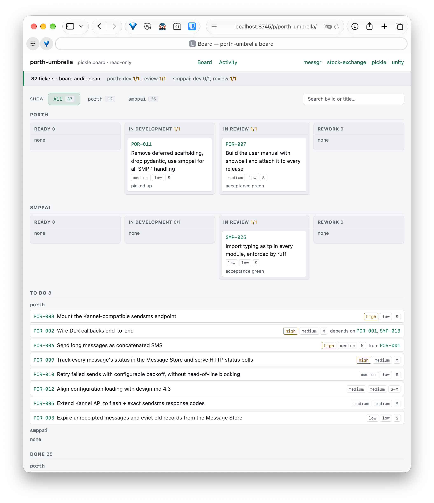

# pickle

`pickle` installs and operates **brine**. Brine is a ticket-based workflow for
software development, designed to be used with any coding agent.

Brine is the name of this particular SDLC. Pickle is a command-line tool that
installs Brine.

Run `pickle install` in a project and a coding agent understands requests like
*"create a feature to enable dark theme"*: it authors a correctly-formatted
ticket in `tickets/1-to-do/T-NNN-<slug>.md` and regenerates `BOARD.md`. All
this is possible because `install` laid down the workflow skill, the board, and
the agent-instruction markers. Judgment (what a ticket says, how it is graded,
refined, reviewed) stays with the agent; the deterministic mechanics (id
allocation, atomic moves, board rendering, invariant audits) are CLI commands.

Use `pickle serve` to visualize the board in a browser.



For the best UX use `pickle` with [Pi](https://pi.dev).

## Is brine right for you?

Brine trades speed per change for a written record of every change. Every feature goes
through a ticket that is planned, gated, built, reviewed and merged, and all of it is
stored as markdown in your repository.

**It fits when:**

- Work spans many sessions or many agents, and the plan has to outlive the context window
  of the agent that wrote it.
- You want an agent to plan before it builds, and you want to approve that plan. A ticket
  can't be picked up until its Implementation Plan passes the READY gate.
- You want reviews whose findings are recorded and resolved, not lost in chat.
- You want the backlog, history and design decisions in git, next to the code, readable
  without any service.
- A human keeps the last word: agents commit locally, but pushing, opening a merge request
  and merging wait for you.

**It doesn't fit when:**

- The project is a one-off script, a spike or a prototype you'll throw away.
- Most changes are small and immediate, and a ticket round-trip would cost more than the
  change itself.
- Your team already plans in an external tracker (Jira, Linear, GitHub Issues) and wants
  to keep it. Brine doesn't sync with one, and running two boards means two sources of
  truth.
- You want agents to push and merge on their own. Brine is built around human gates.

**What it costs day to day.** One ticket per feature, each with a dated History. A WIP
limit: one ticket in development and one in review per project, by default. Bookkeeping
commits on the base branch, separate from feature branches. Your agent does most of this
through the skill; you mostly approve plans and merges.

**What `pickle install` adds.** A `tickets/` directory with a generated `BOARD.md`,
`pickle.toml`, the brine skill under `.agents/skills/brine/`, a marked block in
`AGENTS.md`, and per-agent wiring for Claude Code, opencode or Pi. Git hooks are optional,
via `--hooks`.

**Leaving.** `pickle uninstall --dry-run` lists what would be removed, and `pickle uninstall`
removes it. Your tickets and `pickle.toml` stay, so you keep the record. `--purge` also
deletes them, and refuses if any ticket holds work.

## Install

> **Two different "installs."** *This* section installs the **`pickle` binary**
> on your machine. The `pickle install` *command* is a separate step you run
> **inside a project** to lay down the workflow (skill, board, markers).

Run:

```sh
brew tap codcod/tap
brew trust --formula codcod/tap/pickle
brew install codcod/tap/pickle
```

On Debian or Ubuntu, `sudo apt install pickle` after adding the Cloudsmith repository
`codcod/pickle-cli`. The [user manual](docs/user-manual/installation.adoc#debian-and-ubuntu-apt)
has the one-line setup and the hand-written source line.

On Windows, download `pickle_<version>_windows_amd64.zip` (or `_arm64`) from the
[latest release](https://github.com/codcod/pickle/releases/latest), unzip it, and put
`pickle.exe` on your `PATH`. `pickle install` links `.claude/skills/brine` to the skill
directory. Windows only allows that with Developer Mode on (or as an administrator), so
without it pickle writes a copy of the skill there instead, and `pickle upgrade` keeps that
copy current. If the project you clone already commits those paths as symlinks, turn on
Developer Mode and run `git config --global core.symlinks true` *before* cloning; otherwise
git checks them out as small placeholder files. `pickle doctor` reports those, and
`pickle upgrade` replaces the `.claude/skills/brine` placeholder with a copy that git will
then show as changed. Don't commit that change.

Then, inside any project:

```sh
pickle install        # lay down brine
pickle version
```

## Documentation

Each release offers a current version of the user manual in PDF and EPUB
formats.

Both formats are provided by [snowball](https://github.com/codcod/snowball).
